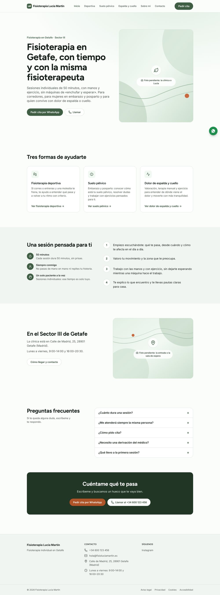
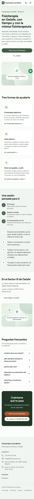
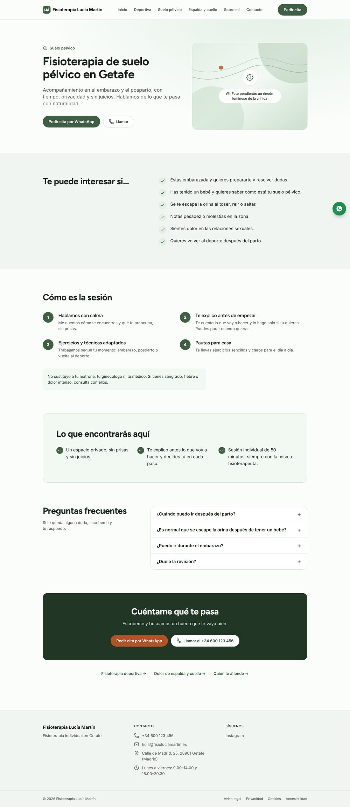
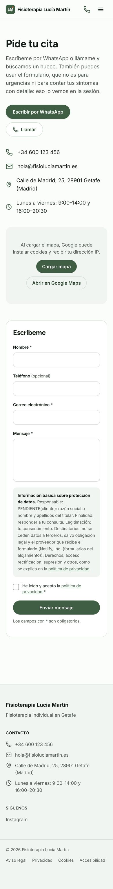
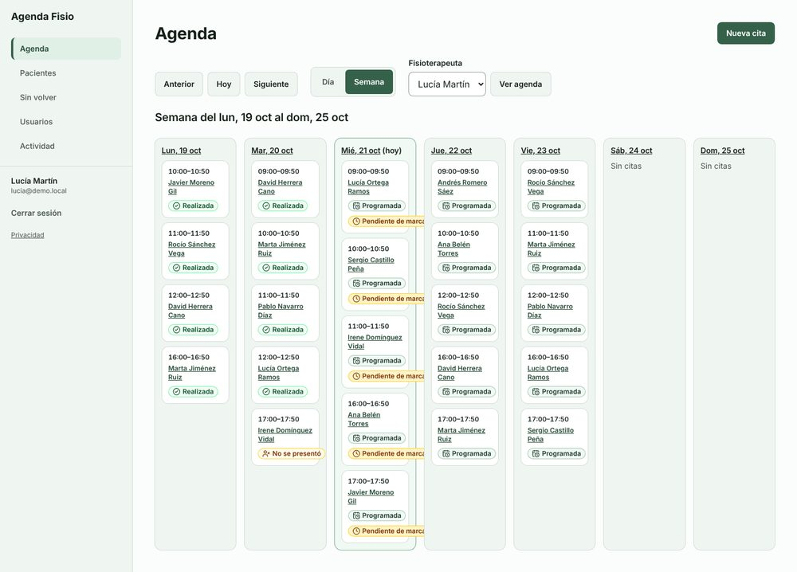
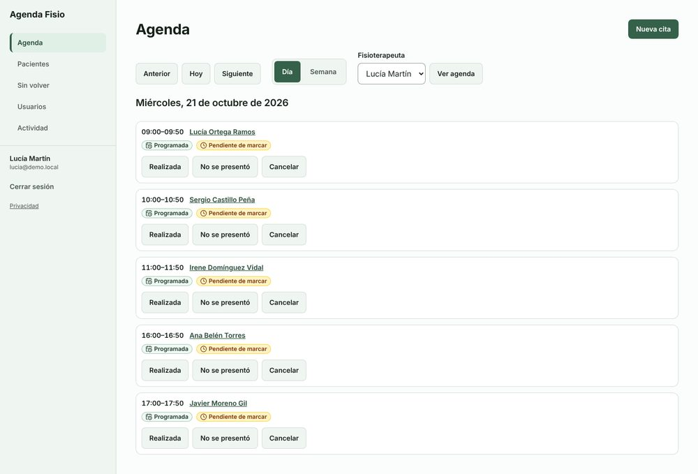
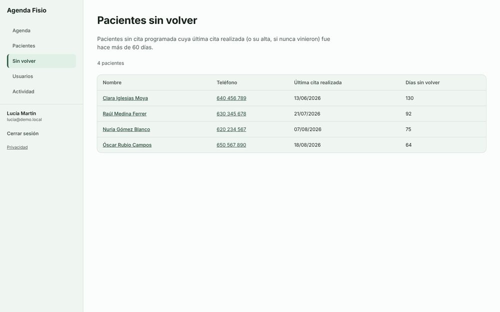
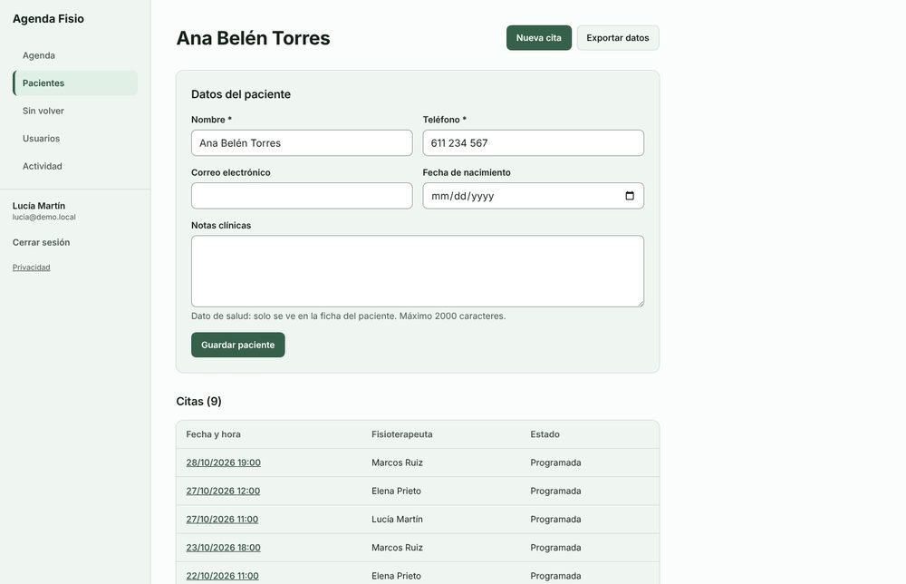
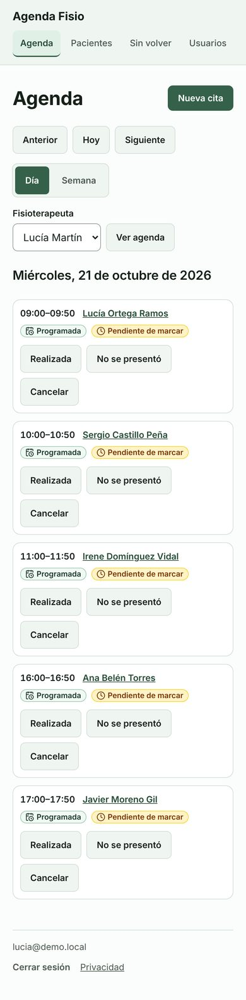
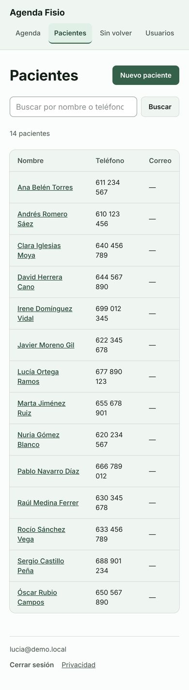

# Ejemplos reales producidos por la fábrica

Estos dos proyectos los generaron las skills **sin intervención humana**, en una prueba de extremo a extremo hecha el 21 de octubre de 2026. Cada skill recibió un brief de comercial (sin entrevista, en modo no interactivo) y trabajó sola hasta la entrega. Se guardan tal como salieron, sin retocar, para que se pueda ver el nivel real del resultado. Solo se han quitado las dependencias y los ficheros de compilación.

Ambos son de un negocio ficticio, «Fisioterapia Lucía Martín» de Getafe, y todos sus datos son inventados para la prueba.

## Web: `web-fisioterapia/`

| | |
| --- | --- |
| Encargo | Web Profesional: inicio, una página por servicio (deportiva, suelo pélvico, espalda y cuello), sobre mí, contacto y legales; WhatsApp, mapa y formulario |
| Tiempo de trabajo autónomo | 32 minutos |
| Resultado | 11 páginas, 49 pruebas de navegador superadas, Lighthouse móvil 100 en rendimiento, accesibilidad, buenas prácticas y SEO en las 10 páginas indexables, 0 fallos graves de accesibilidad y auditoría APTA en modo estricto |
| Entrega | [`ENTREGA.md`](web-fisioterapia/ENTREGA.md), manual del cliente, guía de puesta en producción y guion del vídeo de formación en `docs/` |
| Trazabilidad | [`.fabrica/`](web-fisioterapia/.fabrica/): brief, requisitos, investigación de competencia, dirección visual, textos, 11 decisiones razonadas y 8 pendientes del cliente |

| Inicio (escritorio) | Inicio (móvil) |
| --- | --- |
|  |  |

| Página de servicio | Contacto (móvil) |
| --- | --- |
|  |  |

Lo que la propia entrega reconoce que falta: fotos reales (hay huecos marcados), datos del titular, número de colegiada, validación de los textos sanitarios y revisión legal. La revisión visual automática le puso 3,7 sobre 5, sobre todo por la falta de fotos (después se calibró la rúbrica para estos casos).

Para verla: `cd web-fisioterapia && npm ci && npm run build && npx astro preview`.

## Aplicación: `app-agenda-fisio/`

| | |
| --- | --- |
| Encargo | Herramienta interna de citas para la clínica: pacientes, citas sin solapes, agenda por día y semana, estados de las citas y pacientes que llevan más de 60 días sin volver |
| Tiempo de trabajo autónomo | 62 minutos |
| Resultado | Las 5 historias del brief y 4 piezas añadidas por protección de datos de salud (exportación de los datos de un paciente, registro de actividad con purga a 24 meses y privacidad adaptada). 82 pruebas unitarias y de integración y 124 de extremo a extremo superadas, auditoría APTA y Lighthouse de 97 a 100 |
| Revisiones | Requisitos, código, seguridad y visual, con sus correcciones aplicadas (cálculo de días por calendario, orden de bloqueos para evitar interbloqueos, HSTS, contraste…) |
| Entrega | [`ENTREGA.md`](app-agenda-fisio/ENTREGA.md), manual de usuario, manual técnico, guía de puesta en producción y guion del vídeo en `docs/` |
| Trazabilidad | [`.fabrica/`](app-agenda-fisio/.fabrica/): especificación con la matriz de permisos y las reglas de negocio, arquitectura, plan y decisiones |

Capturas tomadas con datos de demostración (14 pacientes, 3 fisioterapeutas y una semana de citas):

| Agenda semanal | Agenda del día |
| --- | --- |
|  |  |

| Pacientes sin volver | Ficha de paciente |
| --- | --- |
|  |  |

| Agenda en móvil | Pacientes en móvil |
| --- | --- |
|  |  |

**Defecto encontrado en la revisión humana:** en la vista semanal, la etiqueta «Pendiente de marcar» se sale de la columna del día (se ve en la captura). Las capturas automáticas de la prueba se hicieron con la base de datos vacía y no lo mostraron. Por eso la skill exige ahora poblar datos de demostración antes de la auditoría visual. Es el tipo de detalle que la checklist de `ENTREGA.md` pide revisar a mano.

Para probarla: `cd app-agenda-fisio && npm ci`, copiar `.env.example` a `.env.local` con un `BETTER_AUTH_SECRET` generado y `npm run dev`. La primera cuenta que se registra es la administradora.
