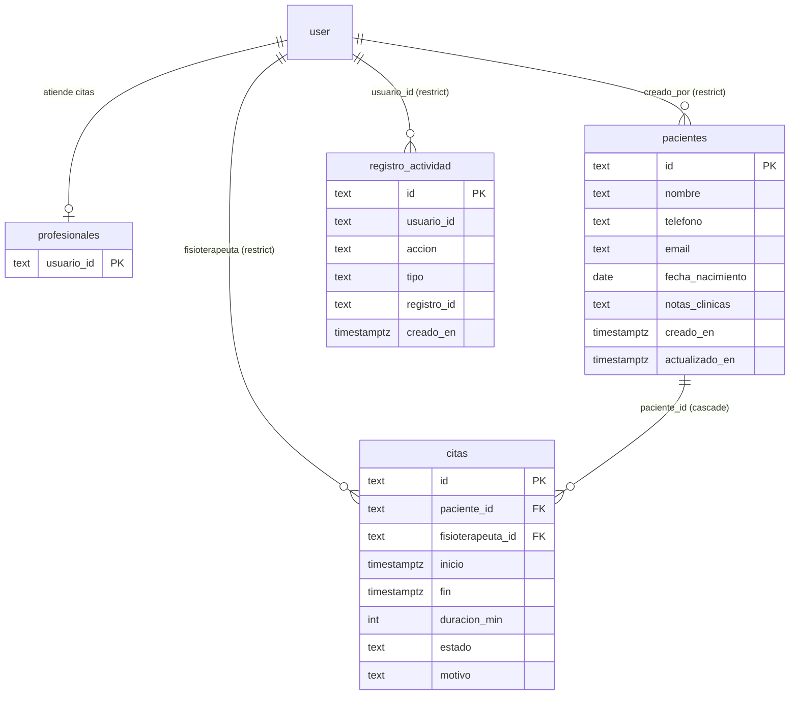
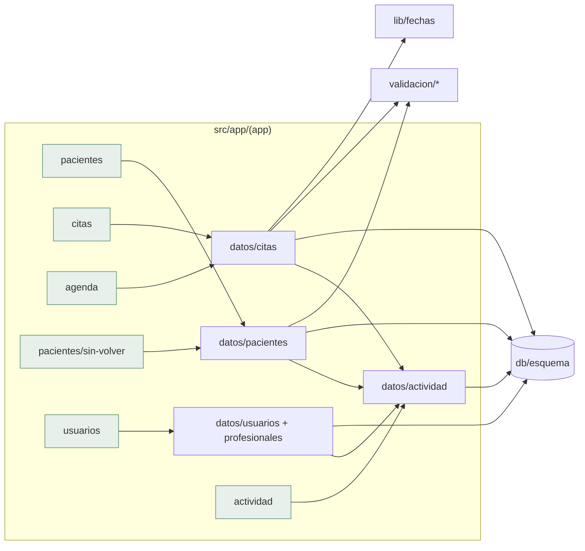

# Arquitectura: Agenda Fisio

Stack fijo de la fábrica (Next.js 16, Drizzle + PostgreSQL/PGlite, Better Auth con plugin `admin`, Zod 4, Vitest + Playwright). Sin app móvil (web adaptada), sin integraciones externas.

## Modelo de datos

- `citas.fin` se guarda calculada (`inicio + duracion`) para consultar solapes e índices sin aritmética en cada consulta. Restricción `CHECK (estado IN (...))` y `CHECK (duracion_min BETWEEN 10 AND 180)`.
- Índices: `citas(fisioterapeuta_id, inicio)`, `citas(paciente_id, inicio)`, `pacientes(nombre)`, `pacientes(telefono)`, `registro_actividad(creado_en)`.
- **Solapes (RN1)**: transacción que toma `pg_advisory_xact_lock(hashtext(fisioterapeuta_id))`, consulta si existe cita con estado `programada`/`realizada` del mismo fisio con `inicio < nuevo_fin AND fin > nuevo_inicio` (excluyendo la propia al editar) y solo entonces inserta/actualiza. El bloqueo serializa las peticiones simultáneas del mismo fisioterapeuta y funciona igual en PGlite y en PostgreSQL. Se descarta una `EXCLUDE USING gist` (dependencia de `btree_gist` no garantizada en PGlite ni en todos los alojamientos).
- Fechas: UTC en base de datos; conversión Europe/Madrid en `src/lib/fechas.ts` (parseo de «fecha + hora local» a instante UTC con resolución de horas inexistentes/duplicadas por cambio de hora, rango de día y de semana de Madrid).

## Permisos

Dos roles. `src/lib/permisos.ts` con reglas `pacientes:ver|editar|eliminar|exportar`, `citas:ver|editar`, `sin-volver:ver`, `actividad:ver`. La capa de datos llama a `exigirPermiso(usuario, …)` en cada función; la UI usa `puede` solo para ocultar. `ErrorPermiso` y `ErrorNegocio` (solape, estado inválido) en `src/lib/datos/errores.ts`.

## Módulos

| Módulo              | Ficheros propios                                                                                           |
| ------------------- | ---------------------------------------------------------------------------------------------------------- |
| Pacientes (H1, H5, T2) | `lib/validacion/pacientes.ts`, `lib/datos/pacientes.ts`, `app/(app)/pacientes/**`, `api/exportar/paciente/[id]` |
| Citas (H2, H4)      | `lib/validacion/citas.ts`, `lib/datos/citas.ts`, `app/(app)/citas/**`                                       |
| Agenda (H3)         | `lib/fechas.ts`, `app/(app)/agenda/**` (usa `datos/citas`)                                                   |
| Equipo (T1)         | `lib/datos/profesionales.ts`, ajuste a `app/(app)/usuarios/**`                                              |
| Actividad (T3)      | `lib/datos/actividad.ts`, `app/(app)/actividad/page.tsx`                                                    |

## Decisiones de diseño

- **Rutas**: `/agenda` (inicio tras entrar), `/pacientes`, `/pacientes/nuevo`, `/pacientes/[id]`, `/pacientes/sin-volver`, `/citas/nueva`, `/citas/[id]`, `/usuarios`, `/actividad`, `/privacidad`. El panel de la plantilla (`/panel`) pasa a redirigir a `/agenda`.
- **Agenda**: día y semana en servidor con parámetros de URL validados (`?vista=dia|semana&fecha=AAAA-MM-DD&fisio=<id>`); móvil: lista por día; escritorio: semana como siete columnas de tarjetas.
- **Estados** con texto + icono + color (no solo color). Cambio de estado mediante botones de formulario (acción de servidor), sin JavaScript obligatorio.
- **Privacidad por diseño**: `listar` de pacientes y la agenda no seleccionan `notas_clinicas` ni `motivo`; solo `obtener` por id.
- **Registro de actividad**: se escribe en la misma transacción que la operación; solo identificadores.
- **Semillas** (`scripts/semillas.ts`) con datos ficticios para el desarrollo y las pruebas de volumen; nunca datos reales.
- **Primera cuenta**: la administradora del hook de Better Auth; un hook `after` le crea su fila en `profesionales` (la dueña es fisioterapeuta).

## Seguridad y datos

Aplica `datos-seguridad.md`: sesión + permiso en página, acción y capa de datos; Zod en el servidor; búsquedas con escape; UUID; cabeceras de seguridad de la plantilla; datos de salud sin exposición en listados, registros ni URL; exportación y supresión por paciente (T2 y borrado en cascada). Alojamiento previsto Vercel (Fráncfort) + Neon UE: pendiente del cliente el contrato de encargo y valorar EIPD.
